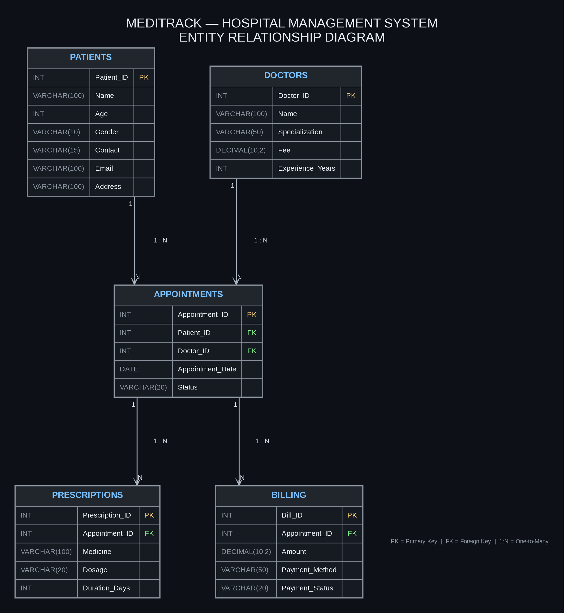

## 🏥 MediTrack — Hospital Management System

  <b>A MySQL-Based Hospital Management Database Project</b>

  
  
  
  

## 📌 Project Overview
MediTrack is a relational database project developed using MySQL to organize and manage essential hospital operations. It provides a structured way to maintain patient information, doctor details, appointments, prescriptions, and billing records.

The project demonstrates practical SQL skills, relational database design, data integrity, indexing, joins, subqueries, and analytical queries.

## 🎯 Objectives
- Design a relational database for hospital management.
- Store and organize patient and doctor information.
- Manage appointments, prescriptions, and billing records.
- Establish relationships between tables using primary and foreign keys.
- Retrieve meaningful information using SQL queries.
- Analyze billing and revenue data using aggregate functions and window functions.

## ✨ Key Features
- Patient Management: Maintain patient details and contact information.
- Doctor Management: Store doctor profiles, specializations, experience, and consultation fees.
- Appointment Management: Maintain appointment records connecting patients and doctors.
- Prescription Management: Store medicine, dosage, and treatment duration information.
- Billing Management: Record billing amounts and payment information.
- Data Integrity: Use primary keys, foreign keys, and constraints.
- Query Optimization: Demonstrate indexing and unique indexes.
- Data Analysis: Use joins, subqueries, aggregate functions, and grouping.
- Views: Create views for high-value bills and revenue summaries.
- Revenue Analysis: Perform cumulative revenue calculations using window functions.

## 🗄️ Database Schema
- The project uses a MySQL database named MediTrack.
- Table
- Description
- Patients
- Stores patient details, contact information, and addresses.
- Doctors
- Stores doctor profiles, specializations, experience, and consultation fees.
- Appointments
- Maintains appointments between patients and doctors.
- Prescriptions
- Stores prescribed medicines, dosages, and treatment durations.
- Billing
- Records billing amounts and payment information.

## Database Tables
- **Patients:** Stores patient details and contact information.
- **Doctors:** Stores doctor profiles, specializations, consultation fees, and experience.
- **Appointments:** Maintains patient appointments with doctors.
- **Prescriptions:** Stores prescribed medicines, dosages, and treatment durations.
- **Billing:** Records billing amounts and payment information.

## 🔗 Entity Relationship Diagram (ERD)
The following diagram illustrates the MediTrack database schema, including the tables, attributes, primary keys, foreign keys, and relationships between entities.

  

## Database Relationships
- **Patients → Appointments:** One-to-many (1:N)
- **Doctors → Appointments:** One-to-many (1:N)
- **Appointments → Prescriptions:** One-to-many (1:N)
- **Appointments → Billing:** One-to-many (1:N)

## Technologies Used
- Database: MySQL 8.0
- Query Language: SQL
- Database Concepts: Relational database design, constraints, indexing, and views
- Development Environment: MySQL Shell

## Key Features
- Primary key and foreign key constraints
- Indexing and unique indexes
- SQL joins and subqueries
- Aggregate functions and grouping
- Cumulative revenue analysis using window functions

## Project Files
- `MediTrack_Hospital_Management_System_Project.docx` – Project documentation
- `MediTrack mysql project.txt` – MySQL Shell transcript
- `NotebookLM Mind Map.png` – Database schema and relationship diagram

## Learning Outcomes
This project demonstrates practical knowledge of relational database design, SQL queries, data relationships, indexing, views, and data aggregation.
